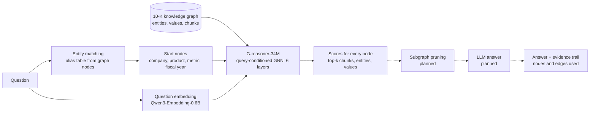

# Report notes: graph retriever and LLM interface (workstream C)

Everything needed to write the **Introduction** and **Method: retriever and LLM interface**, plus the
G-reasoner rows of the results table, for the preliminary report. Every number cites the file it comes
from, so it can be checked or re-derived. Status as of Oct 21, 2026.

The finished prose for the Introduction and Method is in `intro_method.md` (LaTeX: `intro_method.tex`);
this file is the source material behind it and the tables for Experiments and Results.

## 1. Summary in four sentences

We ran the pretrained G-reasoner-34M graph retriever (gfmrag 2.0.0) zero-shot on our rule-based
10-K knowledge graph for J&J, Apple and Microsoft (3,618 nodes, 14,431 edges). On the 11 golden
questions the graph covers, it retrieves a gold chunk in the top 5 for only 2 questions (hit@5 0.18),
while plain cosine similarity on the same Qwen3 node embeddings reaches 0.82 and the bge-small vector
baseline 0.91. A diagnostic shows the pretrained model locks onto the right company but ranks chunks
that are linked only through their header first, and picks the wrong fiscal year for 39% of retrieved
chunks. We therefore fine-tune G-reasoner on synthetic question/subgraph pairs generated from the
graph: 2,135 pairs so far, split by company so the test company is never seen in training.

## 2. Pipeline figure

Solid boxes are implemented and tested; dashed boxes are planned (Oct 29 to Nov 11).



Caption draft: *Retrieval pipeline. Entities named in the question are matched to graph nodes and
become start nodes; G-reasoner propagates from them over the knowledge graph, conditioned on the
question embedding, and scores every node. The top-scoring chunks, entities and numbers form a
subgraph that is pruned and passed to the language model, which answers and cites the nodes and
edges it used.* (mermaid.live renders the block above to SVG/PNG for Overleaf.)

## 3. Method: retriever (what to write)

- **Model.** G-reasoner-34M (`rmanluo/G-reasoner-34M`, gfmrag 2.0.0): a `GraphReasoner` whose core is
  a query-conditioned NBFNet with 6 message-passing layers of width 1024, DistMult messages, sum
  aggregation, layer norm and shortcut connections, with early-late fusion of node text embeddings.
  It outputs a relevance score for every node. (Source: checkpoint `config.json`.)
- **Node and relation features.** Every node is embedded from the text `name / type / attributes`,
  and every relation from its name and description, with Qwen3-Embedding-0.6B (1024-d), the
  embedding model the checkpoint was trained with. Each edge is added in both directions, giving 22
  relation types for our 11.
- **Graph input.** Our graph maps onto G-reasoner's three node types: entities (company, subsidiary,
  location, segment, business line, product, metric, fiscal year), attributes (one node per reported
  number, e.g. `DARZALEX (JNJ) revenue FY2025 = $14,351 million`) and documents (the 10-K chunks,
  named by chunk id). See `../docs/INPUT_FORMAT.md`.
- **Query input.** Start nodes come from matching the question against an alias table built from
  node names (no LLM): "Apple" → `Apple Inc.`, "fiscal 2025" → `FY2025 (AAPL)`, "net sales" →
  `Revenue`. The question is embedded with the same Qwen3 model.
  Suggested wording: *"gfmrag's default entity recognition uses an LLM; we replace it with
  deterministic matching against an alias table built from graph node names, so that training and
  test questions are processed identically and results are reproducible. Letting Gemini choose the
  start nodes instead gives identical start nodes and identical retrieval on the golden questions,
  at about 1.3 s more per question (Section 8)."*
- **Output.** The top-k nodes of each type; for retrieval metrics we use the top-k documents, scored
  against the golden set's gold chunk ids.

## 4. Method: what is fine-tuned, and on how much data

- **What:** all G-reasoner parameters, starting from the pretrained checkpoint, with gfmrag's
  supervised fine-tuning (`SFTTrainer`).
- **Objective (gfmrag defaults):** binary cross-entropy on target documents (weight 0.3), list-wise
  cross-entropy (0.7), and an MSE term (1.0) that distills the question-to-document embedding
  similarity into the GNN's scores. AdamW, learning rate 5e-4, batch size 8, up to 20 epochs, model
  selection by document MRR. On a T4, training uses float16/float32 instead of the default bfloat16.
- **Data:** synthetic question/subgraph pairs generated from the graph (section 6). Currently 1,734
  training and 350 test pairs on `fin10k_v0`; a few thousand once the graph covers all 8 companies,
  holding out 2 companies for test.
- **Ablations planned:** zero-shot vs fine-tuned; with vs without the distillation term (does the GNN
  learn more than embedding similarity?); with vs without the chunk-header links; amount of training
  data.

## 5. Method: LLM interface (planned, not yet built)

- The top-k chunks, entities and numbers plus the graph edges between them form a candidate
  subgraph; it is pruned (G-Retriever-style) to a compact evidence subgraph.
- The LLM receives the question, the pruned subgraph as a list of nodes and edges, and the text of
  the selected chunks, and must answer citing the node and edge ids it used (the evidence trail).
- Generator: Gemini (team decision), with the same generator and judge as the vector baseline so
  answer correctness is comparable. The baseline's `gemini-2.5-flash-lite` is closed to new API keys,
  so the model version has to be agreed with Mahua.
- Planned design detail: the evidence trail is a list of (node, relation, node) triples from the
  retrieved subgraph; the LLM must cite trail entries for each claim, and an automatic check confirms
  every cited node is in the retrieved subgraph, so citations cannot be invented.
- The project plan lists pruning, the prompt and the evidence trail under Mohini (Oct 29 to Nov 11);
  confirm ownership.

## 6. Synthetic training data

Recipe: sample a 2-3 hop path in the graph, write a question whose answer needs that path, keep
the path as the gold subgraph. Questions are written from templates and answers computed from graph
values (no LLM); rewording with an LLM is optional later.
Note: the project plan's recipe asks an LLM to write each question. Suggested wording for the
deviation: *"Questions are generated from templates rather than by an LLM, so every answer is
grounded in the graph and generation is free and reproducible; paraphrasing with Gemini is planned for
the scale-up phase, and the hand-written golden questions remain the test set."*
Source: `make_synthetic_questions.py`, output `synthetic/fin10k_v0/` (`stats.json`).

| Template | Gold path | Pairs | Example question |
| --- | --- | --- | --- |
| lookup | subject → Value → chunk | 600 | What was Johnson & Johnson's DARZALEX revenue outside the United States in fiscal 2025? |
| change | the same Value path in two consecutive years | 600 | How did Johnson & Johnson's DARZALEX revenue in the United States change from fiscal 2024 to fiscal 2025? |
| hierarchy | business line → product → Value → chunk | 123 | Which Johnson & Johnson segment or business line includes DARZALEX, and what was DARZALEX's revenue in fiscal 2024? |
| share | product or segment Value and company Value, same year | 219 | What share of Johnson & Johnson's fiscal 2023 revenue came from DARZALEX? |
| compare | the same metric for two companies | 147 | Which had higher net income in fiscal 2025, Apple or Johnson & Johnson, and by how much? |
| subsidiary | company → subsidiary → jurisdiction (Exhibit 21) | 446 | In which jurisdiction is Janssen Biotech, Inc., a subsidiary of Johnson & Johnson, incorporated or organized? |

- **Splits:** train 1,734 (J&J and Apple), test 350 (every pair involving Microsoft, held out),
  golden_overlap 51 (pairs asking for a number that appears in a golden-set answer for the same
  company, kept out of train and test so the golden questions stay unseen).
- **Gold subgraph size:** 3.6 gold chunks per training pair on average.
- **Quality check:** 40 pairs reviewed with their evidence lines (`review.md`). The first pass found
  awkward wording, which was fixed, and the J&J R&D data error (section 9), which is excluded. All
  spot-checked figures matched the filings.

Example record (hierarchy, 3 hops):

```
Q: Which Johnson & Johnson segment or business line includes DARZALEX, and what was DARZALEX's revenue in fiscal 2024?
A: Oncology (BusinessLine); DARZALEX revenue was $11,670 million in fiscal 2024.
start nodes: Johnson & Johnson, DARZALEX (JNJ), Revenue, FY2024 (JNJ)
gold path:  Oncology (JNJ) -has_product-> DARZALEX (JNJ) -has_value-> "DARZALEX (JNJ) revenue FY2024 = $11,670 million"
            -is_mentioned_in-> JNJ_FY2024_ITEM7_0010, JNJ_FY2024_ITEM8_0114, ...
```

## 7. Experimental setup

- Hardware: Google Colab, NVIDIA T4 (15 GB). Software: Python 3.12.3 venv, gfmrag 2.0.0, vLLM 0.10.2.
- Graph: `fin10k_v0` (Mohini), 3,618 nodes (669 entity, 1,094 attribute, 1,855 document), 14,431
  edges, 11 relations (`data/graph/fin10k_v0/graph_stats.json`).
- Questions: the 11 golden questions whose gold chunks are all in the graph (q01, q03, q06, q08, q09,
  q10, q11, q14, q15, q16, q18); q02, q04, q05, q07, q12, q13, q17, q19 are about companies not yet
  in the graph.
- Metrics: precision@k, recall@k and hit@k from `vector_rag_baseline/rag/metrics.py`, k = 5 and 10.
- Cost: graph embedding 467 s once (cached), model load about 35 s, retrieval about 0.1 s per
  question (median 96 ms, `results/zero_shot_fin10k_v0/per_question.jsonl`). The 260 ms mean in that
  run's `summary.json` includes 1.9 s for the first question, which loads G-reasoner's CUDA kernel (a
  warm-up bug, since fixed). Two runs gave identical retrievals.

## 8. Results

### Main table (11 covered golden questions)

| System | Hit@5 | R@5 | Hit@10 | R@10 | Source |
| --- | --- | --- | --- | --- | --- |
| Vector RAG, bge-small | 0.91 | 0.41 | 1.00 | 0.56 | `vector_rag_baseline/results/full_run_2/per_question.jsonl`, re-scored on the 11 |
| Vector RAG, bge-small + rerank | 0.82 | 0.42 | 0.91 | 0.60 | same |
| Vector RAG, DistilBERT | 0.82 | 0.34 | 0.82 | 0.46 | same |
| Vector RAG, DistilBERT + rerank | 0.73 | 0.37 | 0.91 | 0.52 | same |
| Dense, Qwen3-Embedding (G-reasoner's node features, no graph) | 0.82 | 0.60 | 0.91 | 0.76 | `results/diagnose_fin10k_v0/summary.json` |
| **G-reasoner-34M zero-shot** | **0.18** | **0.04** | **0.18** | **0.04** | `results/zero_shot_fin10k_v0/summary.json` |
| G-reasoner fine-tuned | TBD | TBD | TBD | TBD | |

Only q01 and q10 (Apple net sales) are hits for zero-shot G-reasoner; it retrieves
`AAPL_FY2025_ITEM8_0051` for both.

### Diagnostic (same 11 questions, one model load; `results/diagnose_fin10k_v0/`)

| Variant | Hit@5 | R@5 | Hit@10 | R@10 |
| --- | --- | --- | --- | --- |
| All start nodes | 0.18 | 0.04 | 0.18 | 0.04 |
| Without company and fiscal-year start nodes | 0.00 | 0.00 | 0.09 | 0.05 |
| Only company and fiscal-year start nodes | 0.00 | 0.00 | 0.00 | 0.00 |
| No graph: Qwen3 embedding similarity | 0.82 | 0.60 | 0.91 | 0.76 |

What the retrieved chunks look like (top 10 per question; computed from
`diagnose_per_question.jsonl` and `data/graph/fin10k_v0/processed/stage1/edges.csv`):

| | Chunks linked only through their header | From the wrong fiscal year | Median links per chunk |
| --- | --- | --- | --- |
| G-reasoner zero-shot | 29% | 39% | 5 |
| Qwen3 embedding similarity | 14% | 13% | 9 |
| Gold chunks | 3% | n/a | 18 |
| All 1,855 chunks in the graph | 56% | n/a | |

### Ablation: who picks the start nodes (rules vs Gemini)

gfmrag's default pipeline finds start nodes with an LLM. To check whether our rule-based matcher
holds G-reasoner back, Gemini (`gemini-3.5-flash-lite`, temperature 0) was given each question plus
the list of all 669 entity node names and asked which nodes the question refers to. Graph, model,
questions and metrics are unchanged; both runs are in one Colab runtime.
Sources: `results/gemini_ner_fin10k_v0/` (matching, 60 calls = 20 questions x 3 repeats),
`results/ner_ablation_fin10k_v0/` (retrieval), `g_reasoner_gemini_ner_ablation.ipynb`.

| Start nodes from | Same start nodes (11 golden) | Hit@5 | R@5 | Hit@10 | R@10 | Matching ms | Matching + retrieval ms |
| --- | --- | --- | --- | --- | --- | --- | --- |
| Rule-based alias matcher | – | 0.18 | 0.04 | 0.18 | 0.04 | 3.5 | ~110 |
| Gemini 3.5 Flash-Lite | 11 / 11 | 0.18 | 0.04 | 0.18 | 0.04 | 1,290 | ~1,410 |

- Retrieved lists are identical for all 22 (question, k) pairs, as expected from identical start nodes.
- Speed: matching is about 370x slower with Gemini (3.5 ms vs 1,290 ms per question on Colab;
  1.3 ms vs 1,170 ms measured locally); end to end about 13x slower. Gemini also hit free-tier rate
  limits (HTTP 429/403, handled by retrying), which matters for thousands of synthetic questions.
  Timings leave out the first question, which loads the CUDA kernel in the rule-based run (22.7 s).
- Repeatability: Gemini gave the same answer on all 3 calls for 11/11 golden and 7/9 probe
  questions; once it returned a node name not in the graph ("Innovative Medicine" without "(JNJ)").
  On 2 of 20 questions it copied the node-kind label from the prompt ("Revenue [Metric]"), which we
  strip before checking names.
- 9 paraphrased probe questions (written to stress the alias table; no gold chunks, matching only):
  Gemini is better on 2 ("operating profit" → Operating income, where the rules give Net income;
  it does not map "sales and marketing" to Revenue), the rules are better on 2 (Gemini picks the wrong
  fiscal year for "most recent fiscal year" and misses "Ireland"), 2 are mixed (e.g. "J&J's top line
  last year": Gemini finds Revenue but picks FY2023), 3 are the same.

Conclusion for the report: the start nodes are not why zero-shot G-reasoner fails; an LLM matcher
gives the same result on the golden questions at much higher cost and with some run-to-run variation.
The paraphrase probes show both matchers make mistakes on wording outside the alias table, so matcher
accuracy should be measured on the larger dev set.

Limitation to state: *"The comparison covers the golden questions, where both matchers agree. On
paraphrased questions the matchers differ, but these have no gold labels yet; their effect on retrieval
will be measured on the expanded dev set, before and after fine-tuning."*

### Interpretation (hedged; this is a hypothesis, not yet proven)

The node embeddings carry the signal (0.82 without the graph), so the data pipeline is sound. The
pretrained GNN does not use it on this graph: it finds the right company every time but favors
chunks connected only to the start nodes, which are generic (risk factors, business overview), and
does not separate fiscal years. G-reasoner was pretrained on Wikipedia-style multi-hop QA graphs
where every passage links to its own extracted entities; here 56% of chunks have no entity links
besides their header. Removing the company and fiscal-year start nodes does not help, so the hub
nodes alone are not the cause. Fine-tuning on our graph (section 4) and adding entity links to prose
chunks (Mohini's phase 2, `fin10k_v1`) are the two remedies.

### Evaluation protocol (keep comparisons fair)

Every comparison (zero-shot vs fine-tuned, G-reasoner vs baselines, ablations) holds these fixed and
changes one thing at a time: the graph version (`fin10k_v0` now), the golden-label version, the
start-node matcher (rule-based `entity_index.py`), the metrics (`vector_rag_baseline/rag/metrics.py`,
k = 5, 10) and the question set. If any of them changes (e.g. the 8-company graph, corrected gold
chunk ids, alias-table fixes), every system is rerun before comparing; the zero-shot numbers above are
valid only against other `fin10k_v0` runs. The synthetic test set (`test.json`) is in-distribution
for the templates, so the golden/dev questions are the real test.

## 9. Caveats to state in the report

- 11 questions only: one question moves hit@k by 0.09. Only q01's gold labels are validated; the
  rest come from pattern matching (`vector_rag_baseline/GOLDEN_SET.md`).
- The graph covers 3 of 8 companies.
- Graph data error: J&J's "research and development expense" Values are actually acquired
  in-process R&D charges ($109M FY2025, $1,841M FY2024; `JNJ_FY2025_ITEM8_0008`); J&J's total R&D
  ($14,665M in 2025) is missing. Excluded from the synthetic data; affects golden q06, q14, q18.
- The alias table was written after reading the golden questions, so "11/11 correct start nodes" is
  optimistic; on paraphrases it makes mistakes (Section 8, ablation).
- Gemini model versions: `gemini-2.5-flash-lite` (the vector baseline's generator) is not available
  to new API keys; the Gemini ablation used `gemini-3.5-flash-lite`. Answer-correctness comparisons
  need one agreed model.
- The fiscal years of the three companies end in different months (Apple September, Microsoft June,
  J&J December), which matters for cross-company questions.
- Synthetic questions are template-based and may be easier or more formulaic than real analyst
  questions; held-out companies and hand-written test questions guard against overfitting to them.

## 10. Related-work points (verify against the papers before citing)

These are the points the project plan assigns to this workstream; wording is ours and should be
checked against each paper.

- **G-reasoner** (Luo et al., ICLR 2026): a 34M-parameter graph foundation model for retrieval over
  a typed graph of entities, attributes and documents (QuadGraph); the model we fine-tune.
- **GFM-RAG** (Luo et al.): its predecessor from the same group; same gfmrag code base.
- **G-Retriever** (He et al., NeurIPS 2024): retrieves a subgraph with Prize-Collecting Steiner Tree
  and passes it to an LLM; the graph-to-LLM interface we plan to follow for pruning.
- Non-learned graph retrieval for contrast: HippoRAG (personalized PageRank), LightRAG, GraphRAG.
  Mohini's merged Related Work draft (Oct 20) already covers these, plus GNN-RAG, GFM-RAG and
  G-reasoner. **G-Retriever is missing from it and from `refs.bib`**; add it (He et al., NeurIPS 2024),
  since Section 5 plans G-Retriever-style pruning.

## 11. One-paragraph contribution summary (for Peer Evaluation)

Rida (workstream C): set up the official G-reasoner code and checkpoint on Colab; converted the
team graph into gfmrag's format and fixed the blockers (missing `documents.json`, vLLM out-of-memory
on a T4, PyG version parsing); built entity matching without an LLM; ran and scored zero-shot
G-reasoner on the golden set with the baseline's metrics; diagnosed why it fails; wrote the synthetic
question generator (2,135 pairs, company-held-out split, golden-set leakage guard); compared
rule-based and Gemini entity matching (accuracy, speed, repeatability); documented the input format,
results and pipeline for the report.
